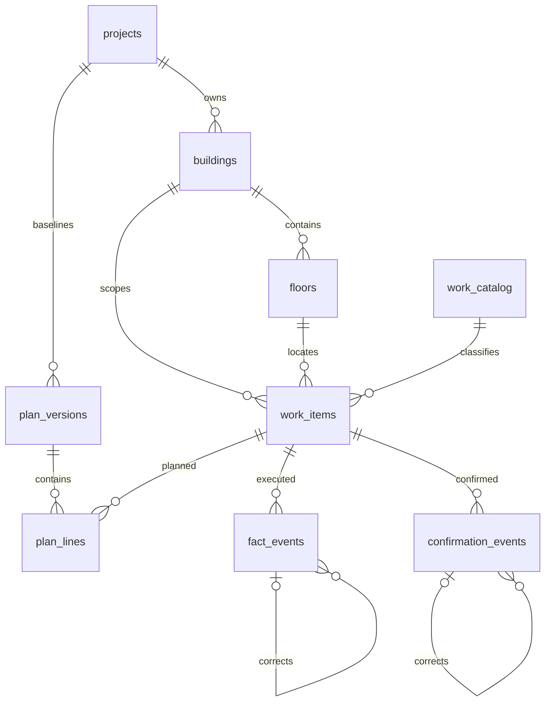

# SQLite: схема этапов 1–3.1

Источник истины — `migrations/001_initial.sql`, `002_replace_guards.sql`, `003_web_workflow.sql` и `004_projects.sql`.
Схема не использует нативные расширения и пригодна для macOS/Windows.

| Таблица | Поля | Ключевые ограничения |
| --- | --- | --- |
| `projects` | id, name, code, description, status, created_at, updated_at | PK id, UNIQUE code, active/archived, обязательные название/код |
| `buildings` | id, project_id, code, name, sort_order, status | PK id, FK project, UNIQUE(project_id,code), active/archived, целый порядок |
| `floors` | id, building_id, floor_code, sort_order | FK building, UNIQUE(building_id,floor_code), UNIQUE(id,building_id), целый порядок |
| `work_catalog` | id, code, work_type, element, name, unit | UNIQUE code, непустые классификаторы и единица |
| `work_items` | id, building_id, floor_id, catalog_id, discipline | FK building/catalog; составной FK(floor_id,building_id); UNIQUE(building_id,floor_id,catalog_id,discipline) |
| `plan_versions` | id, project_id, discipline, version_no, status, approved_at, created_at | FK project, UNIQUE(project_id,discipline,version_no), DRAFT/APPROVED, согласованность статуса и времени |
| `plan_lines` | id, plan_version_id, work_item_id, planned_quantity, labor_norm, **unit** | FK version/item, UNIQUE(version,item), неотрицательные канонические Decimal TEXT, norm может быть NULL только до утверждения |
| `fact_events` | id, work_item_id, quantity_delta, work_date, recorded_at, comment, correction_of_id, **event_key, unit** | FK item/self, UNIQUE event_key, ненулевая подписанная Decimal TEXT, неизменяемость |
| `confirmation_events` | id, work_item_id, quantity_delta, confirmed_date, recorded_at, document_ref, correction_of_id, **event_key, unit, comment** | FK item/self, UNIQUE event_key, обязательный документ, неизменяемость |
| `audit_log` | id, entity_type, entity_id, operation, recorded_at, details | INSERT/UPDATE/DELETE, неизменяемость; details содержит OLD/NEW значения в SQL-литералах |
| `schema_migrations` | name, applied_at | PK name, служебная история применения миграций |

Добавленные к заданию `unit` — снимки единицы для контроля совместимости;
`event_key` — стабильный ключ исходного события для защиты от повторного импорта.
Без этих полей невозможно надёжно различать несовместимые единицы и повторы регистрации.
Этап 2 добавил отдельный `confirmation_events.comment`, не заменяющий документ-основание.
Для существующих записей он получает пустую строку; исходные даты, объёмы и ссылки сохраняются.

`discipline`: `DESIGN` (проектирование) или `CONSTRUCTION` (СМР).
В одной версии плана может быть только одна дисциплина; триггер проверяет каждую строку.
Смешанный показатель проекта намеренно не определён.

`planned_quantity`, `labor_norm`: десятичные строки без знака, экспоненты,
ведущих нулей и дробных хвостовых нулей. Например: `0`, `1000`, `0.8`.
`quantity_delta`: тот же формат с необязательным `-`; `0` и `-0` запрещены для события.
Предел входа: 18 целых и 9 дробных разрядов. Нулевые объёмы/нормы допустимы
в черновике для подготовки данных, но препятствуют утверждению и достоверному расчёту.

Даты работ и подтверждения: `YYYY-MM-DD`, проверяются календарная корректность и формат.
Даты регистрации/создания/утверждения: фиксированный UTC
`YYYY-MM-DDTHH:MM:SS.ffffffZ`, что обеспечивает точное лексикографическое сравнение.
Служебный `schema_migrations.applied_at` использует стандартную UTC-метку SQLite.
Аудит записывает фактический момент операции БД; `recorded_at` события при доверенном
импорте может представлять более ранний момент регистрации в источнике.

Триггеры:

- Запрещают UPDATE/DELETE событий и аудита; явные коллизионные проверки блокируют `REPLACE`.
- Защищают утверждённые версии и их строки от всех изменений и замены.
- Запрещают прямое создание утверждённой версии и утверждение пустого/неполного плана.
- Проверяют соответствие дисциплины и единицы позиции/плана/события.
- Проверяют принадлежность корректировки той же позиции и её хронологию.
- Фиксируют вставки, изменения и удаления основных сущностей в аудите атомарно.
- Защищают используемую классификацию от изменения, предотвращая дрейф исторических групп.

В миграции 003 защита этажа уточнена: используемый этаж можно переставлять через
`sort_order`, но нельзя менять `id`, `building_id` и `floor_code`. Для кодификатора
защита используемых записей сохранена. Аудит новой записи подтверждения включает
как документ, так и комментарий. Новых учётных таблиц веб-интерфейс не создаёт.

Индексы журналов: `(work_item_id, business_date, recorded_at)`;
плана: `(project_id,discipline,status,approved_at,version_no)`. Все FK действуют без каскадного удаления.
`PRAGMA foreign_keys=ON`, `recursive_triggers=ON`, `busy_timeout=5000` задаются на каждом
соединении приложения. Журнал транзакций — стандартный rollback journal SQLite.

Межстрочные ограничения `SUM(confirmed) <= SUM(actual)` и неотрицательность накоплений
проверяются репозиторием в Decimal под `BEGIN IMMEDIATE`, по всем историческим границам.
Они не выражены в SQL через `SUM(TEXT)`, поскольку SQLite преобразовала бы строки
в двоичные числа. Расчётное ядро повторно проверяет их для выбранного среза.
Записывать производственные данные следует через репозитории.

## Объектная область и миграция 004

`project_id` хранится только в `buildings` и `plan_versions`. Этаж → корпус → объект;
позиция → корпус → объект; события → позиция. Кодификатор общий. Триггеры строк
плана запрещают ссылки между объектами, дополнительно к существующим проверкам
дисциплины и единицы. Перенос корпуса или версии в другой объект запрещён.
Названия/коды/порядок корпуса разрешено менять с сохранением `building_id`.

Глобальные UNIQUE кода корпуса и номера версии заменены составными. Для этого
таблицы пересоздаются под `BEGIN IMMEDIATE` через новые временные таблицы, без
`REPLACE`. Перенос сохраняет все исходные поля и ID. Контроль FK временно отключается
вне транзакции только для пересоздания, затем FK и `integrity_check` проверяются
до COMMIT; настройки всегда восстанавливаются, включая ошибку. Индексы и триггеры
восстанавливаются. Приложение проверяет количество и SHA-256 содержимого исходных
колонок всех учётных таблиц и аудита до/после DDL.

Перед обновлением существующего файла используется SQLite Backup API; копия
проверяется и сохраняется в соседнем каталоге `backups`. При ошибке 004 её изменения
откатываются, копия сохраняется. Успешные предыдущие миграции остаются применёнными.
Повторный запуск пропускает 004 и не создаёт новый объект или повторные корпуса.
Свежая установка получает прежние А/B/C один раз; новые объекты — только указанные
пользователем корпуса. Физического удаления объектов в API нет: используется архив.
