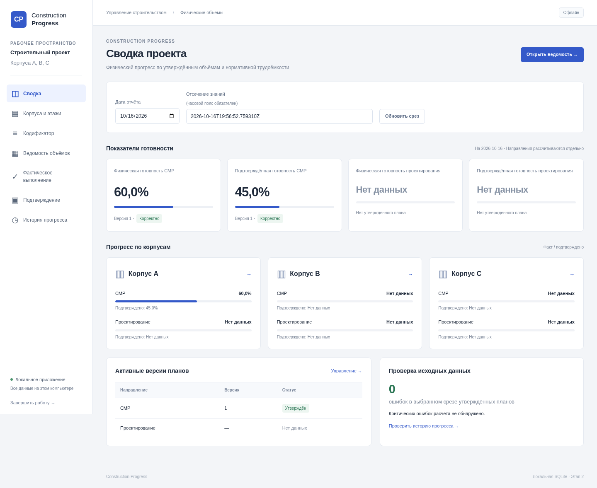

# Веб-интерфейс — этап 2

Интерфейс интегрирован в существующий проект. Миграции 001/002 и формулы первого
этапа сохранены. Flask-маршруты валидируют формы, вызывают репозитории/сервис и
рендерят Jinja2. JavaScript обслуживает подтверждение действий и зависимые списки,
но не вычисляет объёмы, трудоёмкость или готовность.

## Разделы и операции

| Раздел | Адрес | Возможности |
| --- | --- | --- |
| Сводка | `/` | Четыре раздельных показателя, корпуса А/B/C, даты, активные версии и ошибки |
| Корпуса и этажи | `/buildings` | Добавление, порядок, удаление свободного этажа |
| Кодификатор | `/catalog` | Поиск с casefold для кириллицы, фильтры, новые коды и разрешённое редактирование |
| Ведомость объёмов | `/volumes` | Позиции, шесть фильтров, черновики, план/норма, утверждение, расчёт |
| Фактическое выполнение | `/facts` | Независимые события, корректировки и история |
| Подтверждение | `/confirmations` | События с документом и комментарием, корректировки и история |
| История прогресса | `/progress` | Строгий исторический срез, остатки и диагностика |

Чтение списка корпусов также доступно через локальный `GET /api/buildings`.
Все изменения — POST, успешная запись завершается перенаправлением 303.
Репозитории выполняют запись и аудит в одной транзакции SQLite.

В утверждённой версии поля плана недоступны; поддельный POST также отклоняется.
Предпросмотр черновика вызывает явно выделенный метод существующего ядра и
помечается как предварительный. Сводка использует только доступные утверждённые планы.
В истории выбранная черновая или ещё недоступная версия возвращает ошибку.

Объёмы вводятся с точкой или запятой. Экспоненты, NaN, бесконечности, дробные ID,
неверные даты, несовместимые связи корпус/этаж/позиция и отсутствие обязательного
документа отклоняются сервером. Пользователь не задаёт момент регистрации события:
он назначается автоматически в UTC. Ключ записи генерируется для формы и сохраняется
при её повторной отправке, защищая журнал от дублирования.

Превышение подтверждения над фактом и недопустимые корректировки отклоняются
репозиторием с откатом события и аудита. Отдельной сущности утверждения/подписания
отчёта на этом этапе нет. Недостоверный исторический срез показывает ошибку и
причину; достоверный процент при этом не подставляется.

## Локальный сервер и защита

- WSGI-сервер Werkzeug привязывается непосредственно к `127.0.0.1` и порту `0`
  (свободный порт назначает ОС). Аргумента для публикации на другом интерфейсе нет.
- Debug mode и reloader отключены. Браузер открывается после привязки порта.
- На каждый запрос открывается отдельное SQLite-соединение с FK и триггерами;
  оно закрывается при завершении запроса. Отчёты читают согласованный снимок.
- Для всех запросов проверяются точный Host и loopback-адрес клиента.
- Для любого изменения требуется точный `Origin` локального сервера и CSRF-токен
  из подписанной сессии. Отсутствующий Origin, `null`, другой порт/хост/схема и
  `Sec-Fetch-Site: cross-site` отклоняются. Токены сравниваются за постоянное время.
- Секрет сессии создаётся на каждый процесс. Cookie — HttpOnly, SameSite=Strict;
  имя включает порт, чтобы независимые локальные запуски не перетирали сессии.
- `Referrer-Policy: same-origin` сохраняет корректный Origin обычных HTML-форм
  внутри приложения и не передаёт referrer внешним сайтам. `no-referrer` здесь
  не применяется: в Chromium он превращает Origin навигационного POST в `null`.
- CSP разрешает только собственные ресурсы, запрещает встроенные скрипты,
  сторонние формы, frame embedding и объекты. Jinja2 экранирует пользовательский HTML.
- SQL находится в репозиториях; значения передаются параметрами. Имена таблиц и
  столбцов для двух журналов выбираются из фиксированных внутренних констант.
- Ошибки ввода показываются по-русски. Неожиданные исключения получают безопасную
  страницу 500; traceback и внутренние сведения не отправляются пользователю.
- «Завершить работу» — защищённый POST. Сервер завершает текущий запрос и закрывает
  сокет. SIGINT, SIGTERM и SIGHUP также приводят к штатному завершению.

Это однопользовательский локальный сервер. Закрытие вкладки не завершает процесс;
кнопка завершения или Ctrl+C освобождают порт. При повторном запуске открывается
тот же SQLite-файл, а не новая пустая база.

## Результаты проверок

Хост: Linux x86_64, CPython 3.13.5, SQLite 3.46.1. Целевой Mac не использовался.

```text
До изменений: 94 passed in 0.50s
После изменений: 142 passed in 2.42s
```

Сохранены 94 исходных теста и добавлены 48 тестов. В прежнем тесте повторного
открытия БД фиксированное число миграций заменено числом файлов миграций; сам
сценарий и проверки данных сохранены.

Новые проверки включают все семь страниц, список корпусов, этажи, позиции,
черновики/утверждение/неизменяемость, факт, подтверждение, корректировки, исторические
даты, Decimal, сохранение после повторного открытия, CSRF/Origin/Host, экранирование,
безопасные ошибки, жизненный цикл сервера и открытие локального браузера.
Отдельный тест создаёт настоящую схему первого этапа, сохраняет данные, применяет
миграцию 003 и проверяет неизменность строк плана и прежнего результата 45%.

Браузерная проверка Playwright + Chromium **154.0.8037.57** выполнена на отдельной
временной базе. Через реальные формы создан этаж, позиция и черновик, введены план
1000 и учебная норма 0,8, утверждена версия, зарегистрированы 600 факта и 450 подтверждения.
Сводка, ведомость и история показали **60% / 45%**. Проверены ширины окна 1440,
1280, 1024 и 390 px; горизонтального переполнения страницы нет, таблицы прокручиваются
в своих контейнерах. Ошибок JavaScript и внешних запросов не обнаружено.
Финальные скриншоты сняты с локалью браузера ru-RU; HTTP-ошибок загрузки ресурсов нет.
Завершение через браузер остановило сервер с кодом 0.

`start.command` дополнительно запущен из `/tmp` в копии исходников по пути с
пробелами и кириллицей, на копии временной базы. Три последовательных запуска
сохранили 60% / 45%. Завершение через SIGINT, SIGTERM и SIGHUP каждый раз:

```text
exit_code = 0
port_closed = true
integrity_check = ok
foreign_key_check = 0 нарушений
```

Также выполнены `compileall`, `bash -n start.command` и проверка точных версий
зависимостей. Все pytest-тесты выполняются без сетевых разрешений. Для реального
браузерного прогона использовались разрешения на локальные сокеты; обращения наружу
не выполнялись и блокировались проверочным браузерным перехватчиком. Рабочая база
пользователя не использовалась для тестов и скриншотов.

## Скриншоты

Учебные данные находятся только во временной проверочной базе. Норматив на
скриншотах не является справочным и не загружается в рабочую базу.

- [Сводка](screenshots/dashboard.png).
- [Ведомость объёмов](screenshots/volumes.png).
- [История прогресса](screenshots/progress.png).
- [Подтверждение](screenshots/confirmations.png).



## Созданные файлы

```text
app/services/__init__.py
app/services/progress_service.py
app/web/__init__.py
app/web/forms.py
app/web/views.py
app/web/server.py
app/web/routes/__init__.py
app/web/routes/dashboard.py
app/web/routes/buildings.py
app/web/routes/catalog.py
app/web/routes/volumes.py
app/web/routes/events.py
app/web/routes/progress.py
app/web/templates/base.html
app/web/templates/_macros.html
app/web/templates/_filters.html
app/web/templates/dashboard.html
app/web/templates/buildings.html
app/web/templates/catalog.html
app/web/templates/volumes.html
app/web/templates/events.html
app/web/templates/progress.html
app/web/templates/error.html
app/web/templates/stopped.html
app/web/static/css/app.css
app/web/static/js/app.js
app/web/static/favicon.svg
migrations/003_web_workflow.sql
requirements/web.txt
tests/test_web.py
tests/test_web_services.py
docs/core.md
docs/web.md
docs/screenshots/dashboard.png
docs/screenshots/volumes.png
docs/screenshots/progress.png
docs/screenshots/confirmations.png
```

Изменённые существующие файлы:

```text
app/repositories/work_repository.py
app/repositories/event_repository.py
app/calculation_engine/historical.py
app/calculation_engine/models.py
main.py
start.command
scripts/check_environment.py
requirements/macos_catalina.txt
tests/test_database.py
README.md
docs/schema.md
docs/compatibility.md
```

## Оставшиеся задачи

Приёмка на Catalina Intel и macOS 13+ Intel/Apple Silicon, включая Safari, остаётся
обязательной. Следующие инженерные задачи — оценка удобства на реальных данных,
пагинация больших журналов, профилирование проверки истории и резервное копирование.
Упаковка `.app`, Excel и Windows-версия не начинались.


## Рабочие пространства (этап 3.1)

Текущая версия дополнена разделом «Объекты» (`/projects`), созданием объекта
(`/projects/new`), его настройками (`/projects/<id>`) и переключением (`POST /projects/select`).
Идентификатор выбранного объекта хранится в сессии. Фильтры и версии при переключении
сбрасываются. Все корпусные/плановые/событийные маршруты используют репозитории
с явно переданным `project_id`; изменения по чужому ID отклоняются на сервере.
Формы также передают `workspace_id` для защиты от записи из вкладки старого объекта.
Глобальные проверки CSRF, Origin, Host и loopback сохранены.

Список нового выполнения строится из действующего утверждённого плана, без
дублирования позиций. Элементы/виды работ фильтруются до выбора `work_item_id`.
События исключённых работ остаются в журнале; отдельный режим позволяет корректировать
их историю. Общий кодификатор доступен во всех объектах без копирования.

Новые экраны, снятые в Chromium/Linux на временной базе:

- [Список объектов](screenshots/projects.png).
- [Создание школы с двумя корпусами](screenshots/project-create.png).
- [Настройки школы и корпусов](screenshots/project-school.png).
- [Прогресс выбранной школы: 60% факта / 45% подтверждения](screenshots/workspace-progress.png).

Браузер прошёл создание школы, двух корпусов, этажа, учётной позиции, черновика,
утверждение, факт 600 на плане 1000, подтверждение 450, переключение в исходный
объект и обратно, исторический экран и защищённое завершение сервера. Ошибок
JavaScript и запросов на внешние адреса не было. Проверены экраны 1440×900 и
1366×768. Рабочая база во время браузерного испытания осталась неизменной.
Это не подтверждение совместимости новой версии с Safari/Catalina.


## Сквозное движение объёмов, этап 3.1.1

Разделы `/facts` и `/confirmations` дополнены таблицами позиций, выбором утверждённой
версии, датой среза и отсечением знаний. Подтверждение разделено на вкладки «Ожидают
подтверждения» и «Все работы». Исторический просмотр не отправляет новые события.
Результат и инструкция обновления описаны в [event_flow.md](event_flow.md).

Браузерный сценарий школы, этажа 3 и штукатурки стен прошёл в Chromium/Linux: план 1000,
факт 600, подтверждение 450, остаток 150 и 60%/45%; затем 100/50 довели остаток до нуля,
новый факт 100 вернул работу в ожидающие. Старый срез сохранил 150. Внешних запросов
и ошибок JavaScript нет; рабочая база не менялась. Скриншоты: `flow-facts.png`,
`flow-pending.png`, `flow-all.png` в `docs/screenshots`.
